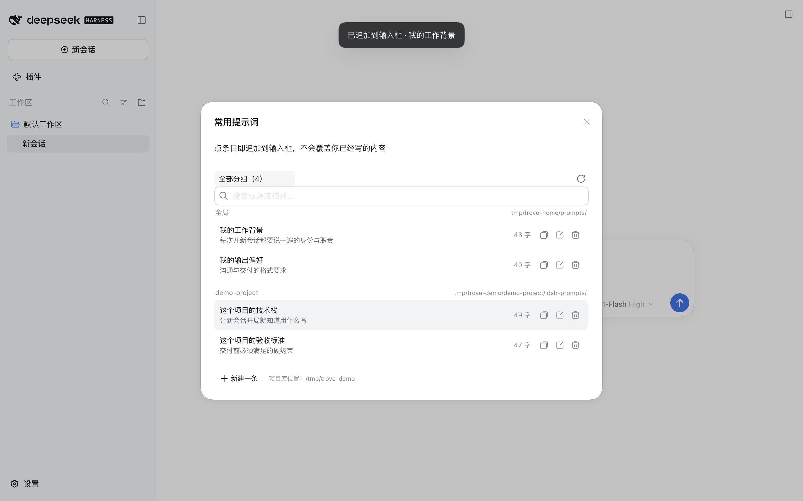

# dsh-prompt-trove

输入框里的「常用提示词」库：把**工作背景、业务背景、输出偏好**这类每次开新会话都要说一遍的内容，存成一段一段的 Markdown，点一下或打 `@` 就追加进输入框。

**点条目 = 追加，不是覆盖。** 你已经写了半句需求，插入背景后那半句还在，两者之间空一行。



## 安装

```sh
dsh plugin --profile web add dsh-prompt-trove
```

重启 `dsh web`。输入框工具行（回形针 / 工作区内修改旁边）会多一个「常用提示词」按钮：


桌面端同样可以装：在设置 → 插件里安装同名包，或在上架后用插件市场一键装。

## 它做什么

- **一层全局库，零配置可用**：`~/.dsh/prompts/global.md`，放你的身份、行业语汇、输出偏好。
- **一层项目库，按需开启**：`<项目>/.dsh-prompts/<项目名>.md`，跟着项目走，可以直接提交进 git。
- **两种插入方式**：面板里点条目，或在输入框里打 `@` 选条目。两者都不会覆盖你已经写的内容。
- **在界面里增删改**：新建、编辑、删除、搜索；手改 Markdown 后点「重新读取磁盘」就生效，不用重启。
- **纯本地文件**：没有数据库、没有账号、没有网络请求，数据就是你自己的 Markdown。

## 库放在哪

| 层 | 位置 | 放什么 |
| --- | --- | --- |
| 全局 | `~/.dsh/prompts/global.md` | 跨项目通用的身份、行业语汇、输出偏好 |
| 项目 | `<项目>/.dsh-prompts/<项目名>.md` | 只对某个项目成立的背景、技术栈、验收标准 |

全局库装好就能用。项目库要在 profile 的 `cordis.patch.yml` 里给这一行加 `config.root`：

```yaml
# ~/.dsh/profiles/web/cordis.patch.yml
- id: dsh-prompt-trove
  config:
    root: /Users/you/code
```

`root` 的两种用法：

```text
root = /Users/you/code            # 多项目：code 下每个含 .dsh-prompts/ 的一级文件夹是一个分组
  ├─ alpha/.dsh-prompts/alpha.md        → 分组 alpha
  └─ beta/.dsh-prompts/beta.md          → 分组 beta

root = /Users/you/code/alpha      # 单项目：项目自己含 .dsh-prompts/ 就是一个分组
  └─ .dsh-prompts/alpha.md              → 分组 alpha
```

没配 `root` 时面板只显示全局库，不会去扫你的磁盘。测试时可以用环境变量 `DSH_PROMPT_SNIPPETS_ROOT` 临时覆盖。

## 文件格式

```markdown
# 分组名

<!-- 一条 = 一个 `## ` 段落；正文原样进入输入框。 -->

## 我的工作背景
> 一句话说明（列表里显示） #身份 #背景
我在 XX 公司负责 XX，团队 3 人……

## 我的输出偏好
> 标签可以没有
回答用中文，结论先行……
```

- `## 标题` = 一个条目，同一文件内标题必须唯一。
- `> ` 开头的一行 = 列表里显示的说明；写在说明里的 `#标签` 会被识别成标签。
- 标题下面、正文之前的内容都属于正文，插入时原样进入输入框。
- 文件的 `# 标题` 和注释只是给人看的，插入时不带。

示例见 [`examples/`](examples/)。

## 局限（诚实说明）

- **项目库需要手动指定 `root`**，不会自动跟随当前会话的项目目录。DSH 0.2 的输入槽不向客户端插件暴露 `sessionId`，宿主拿不到"这个输入框属于哪个项目"；等这条契约变化后可以改成自动跟随。
- **插入的是文本，不是记忆**：和手打一遍等价，只影响当前这条消息；换会话不会自动带上。
- 条目建议控制在 300–600 字：插入的成本就是这部分 token，列表里常显字数就是为了让这个成本看得见。
- 界面文案目前只有中文。

## 兼容性

`package.json` 声明 `engines.dsh: ">=0.2.0-rc.1 <0.3.0"`，实测于 DSH 0.2.0-rc.2。插件贴着这些契约写，DSH 升级若改动它们需要跟着修：

- 客户端槽位 `conversation.input.left` 与 `useInput` / `inputActions`；
- `ctx.slots.inject` / `ctx.slots.register` 的注册语义；
- `ctx.inputTriggers.registerSource` 的候选 / 选取契约；
- 宿主侧 `ctx.webServer.register` 的路由注册；
- `@deepseek-ai/dsh-client-ui-primitives` 的 `Button` / `Modal` / `Input` / `Toast` / `Tooltip` 与 `…OutlineMedium` 图标导出名；
- 主题变量 `--dsw-*` 改名只会影响外观。

## 数据与隐私

- 只读写两个目录：`$DSH_HOME/prompts/` 和 `config.root` 下各项目的 `.dsh-prompts/`。
- 宿主半边只注册 6 条本地 HTTP 路由，全部只接受同源 JSON 请求；文件名、分组名都做过路径穿越校验。
- 没有遥测、没有外部请求、没有账号体系。
- 删除条目会直接改磁盘上的 Markdown；删掉分组里最后一条时，文件本身也会被删除。

## 卸载

```sh
dsh plugin --profile web remove dsh-prompt-trove
```

你的 Markdown 文件不会被删除。

## 开发

```sh
npm install
npm run build          # client-source.jsx → client.js
npm run verify         # 无头自检：bundle 加载 + 宿主路由（不需要浏览器）
npm run e2e            # 真机：需要一个装好插件的 dsh web 实例 + 系统 Chrome
```

`npm run e2e` 读 `DSH_WEB_URL`（`dsh web` 启动时打印的 `http://…/?token=…`），必要时用 `CHROME_PATH` 指定浏览器，截图写到 `assets/`。

发布流程见 [PUBLISH.md](PUBLISH.md)。

## License

MIT
